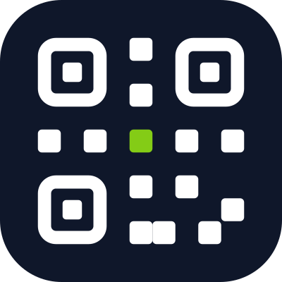

<p align="center"></p>

# qrlia MCP server

Create and manage dynamic QR codes and read their scan analytics from Claude, Cursor and any other MCP client.

**Remote server:** `https://mcp.qrlia.com/mcp` (Streamable HTTP, OAuth sign-in). Nothing to install or run.

[qrlia.com](https://qrlia.com/mcp-gateway?utm_source=github&utm_medium=repo&utm_campaign=mcp-launch) · [Claude directory](https://claude.ai/directory/connectors/qrlia) · Official MCP Registry: `com.qrlia/qrlia` · [API docs](https://docs.qrlia.com)

This repository holds connection instructions only. qrlia is a hosted service; the server code is not open source.

## What you can do

- Create dynamic QR codes: URL, vCard and digital business cards, Wi-Fi, menus, landing pages, PDFs, coupons, lead forms and more.
- Change where a printed code points without reprinting it.
- Get any code as a PNG or SVG image, with your saved designs (colours, shapes, logo, frame).
- Organise codes in folders, templates and companies; create up to 200 at once.
- Read scan analytics by day, country, device and referrer.

64 tools in total. Read-only and destructive tools are annotated, so your client can ask before changing anything.

### Try asking

- "Create a QR code for https://example.com called Spring flyer and show me the image."
- "Show scan analytics for the last 30 days: which codes were scanned most, and from which countries?"
- "Change the Spring flyer code to point to https://example.com/summer."
- "Make a vCard QR code for my business card with my name, phone and email."

## Connect

You need a qrlia workspace. The free plan includes 3 QR codes: [sign up](https://qrlia.com/apply?utm_source=github&utm_medium=repo&utm_campaign=mcp-launch).

### Claude (web, desktop, mobile)

Open [qrlia in the Claude directory](https://claude.ai/directory/connectors/qrlia) and click **Connect**. Or: Settings → Connectors → Add custom connector → `https://mcp.qrlia.com/mcp`.

### Claude Code

```bash
claude mcp add --transport http qrlia https://mcp.qrlia.com/mcp
```

Then type `/mcp`, pick **qrlia** and **Authenticate**.

### Cursor, VS Code, Windsurf, Cline and other clients

Add a remote MCP server with this configuration (also in [`.mcp.json`](.mcp.json)):

```json
{
  "mcpServers": {
    "qrlia": { "type": "http", "url": "https://mcp.qrlia.com/mcp" }
  }
}
```

The client opens the qrlia sign-in in your browser.

### Signing in

Enter your workspace name, sign in, choose what the app may do (read, write; admin only for workspace admins), and allow. Every action runs as you, with your role. Disconnect any time under Settings → Connected apps in qrlia.

Scripts and CI can use an API key instead (paid plans): `Authorization: Bearer qrc_…`.

## Support

support@qrlia.com · [Privacy](https://qrlia.com/privacy) · [Terms](https://qrlia.com/terms)
